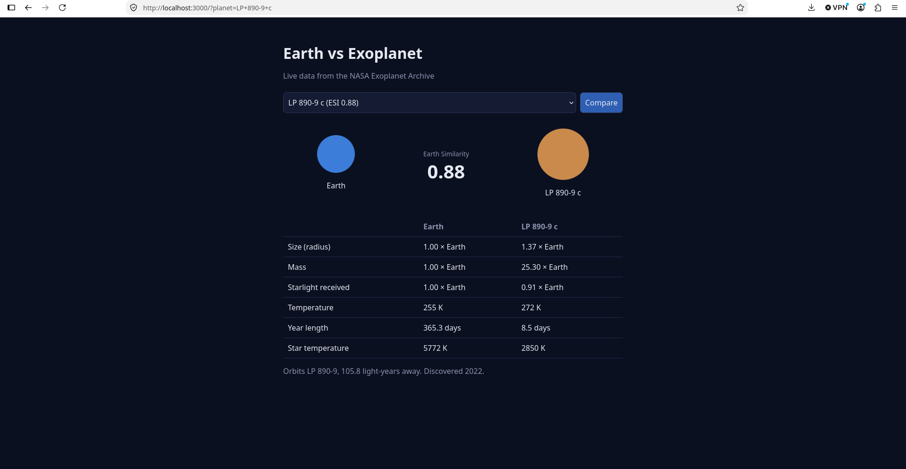

# Earth vs Exoplanet (TypeScript)

Pick an Earth-like planet from the [NASA Exoplanet Archive](https://exoplanetarchive.ipac.caltech.edu/)
and compare it side by side with Earth.

All the code is TypeScript running on the server. The server fills in an EJS template to build the HTML page

## Screenshot



## Run it

Needs Node.js 18 or newer.


npm install
npm start


Open http://localhost:3000.

## Files

```
src/
├── planets.ts   # Planet type, NASA request, Earth Similarity score, comparison rows
└── server.ts    # Web server: picks the planet and renders the template
views/
└── page.ejs     # The HTML page, with gaps the server fills in
public/
└── style.css
```

## How it works

1. `planets.ts` sends NASA a query for planets 0.5–1.8× Earth's size that get 0.25–2× Earth's starlight.
2. Each planet receives a custom Earth similarity score calculated using its radius and the amount of starlight it receives. A score closer to 1.0 indicates a closer match to Earth based on these two properties. The list is sorted best match first and kept for an hour.
3. Choosing a planet in the dropdown and pressing **Compare** loads `/?planet=<name>` and the server passes that planet to `views/page.ejs`, which shows it next to Earth.

## Why I chose this

I decided to make this project as I have a great interest in space and earth like exoplanets. I took it as an opportunity 
to start learning TypeScript as I have heard it is good for people who are versed in java

## What I learned

1. This project uses a real public API so I improved my knowledge on things like sending NASA's archive query in ADQL and turning the JSON response into typed objects, this built on my databases knowlege
2. Async code: async/await and why the server shoudln't freeze while it waits for NASA to respond
3. Working with real world data: I learned that NASA's exoplanet data can contain missing values for properties such as mass and temperature. This introduced me to handling nullable values in TypeScript and displaying fallback information without crashing the application.
4. Caching: keeping the results for an hour instead of asking NASA on every page load.
5. Server side rendering and templates: how a server builds the page before sending it and how EJS separates the HTML from the logic.
6. Security basics: why values put into a page need escaping (HTML injection / XSS) and how EJS <%= %> handles it.

## Technologies used
1. TypeScript
2. Node.js
3. EJS
4. HTML/CSS
5. NASA Exoplanet Archive API

